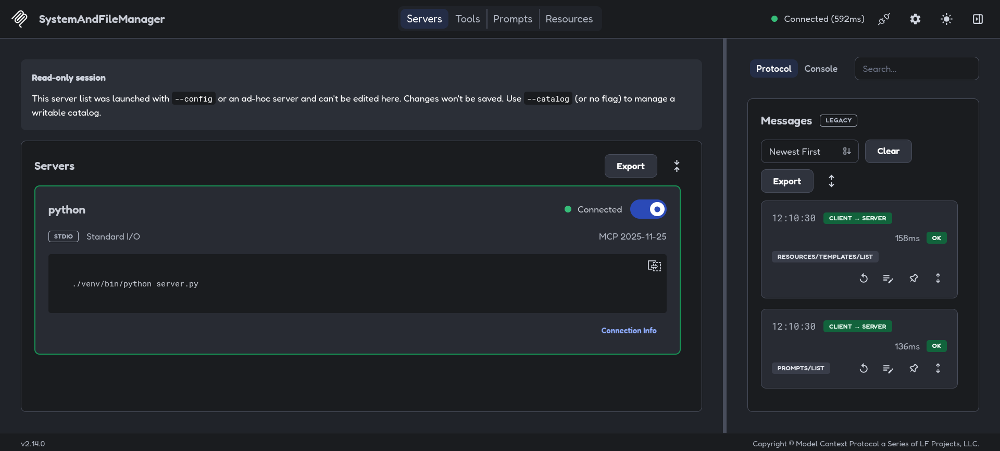
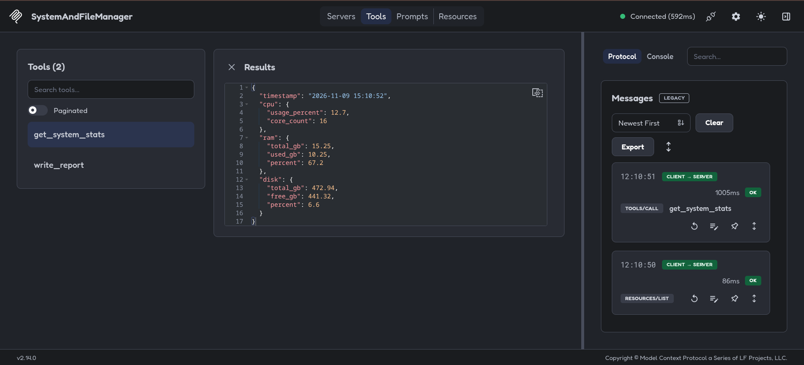
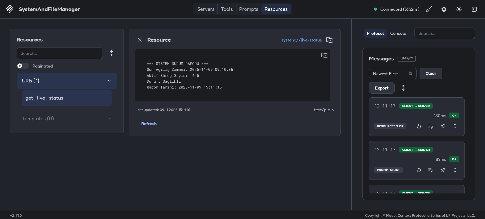

<div align="center">

# 🖥️ System & File Manager MCP Server

[](https://www.python.org/)
[](https://modelcontextprotocol.io/)
[](https://opensource.org/licenses/MIT)
[](https://github.com/Yavuz0707/self-mcp-server)

**Yapay zeka modellerine (Claude Desktop, Cursor IDE vb.) yerel sistem kaynaklarını anlık izleme ve güvenli dosya/rapor yönetimi sağlayan Model Context Protocol (MCP) sunucusu.**

*A Model Context Protocol (MCP) server that empowers AI models (Claude Desktop, Cursor IDE, etc.) with real-time system resource monitoring and secure local file/report management.*

---

[🇹🇷 Türkçe](#-türkçe) &nbsp;|&nbsp; [🇬🇧 English](#-english)

</div>

---

# 🇹🇷 Türkçe

## 📌 Genel Bakış

**System & File Manager MCP Server**, yerel makineniz ile LLM tabanlı yapay zeka istemcileri (Claude Desktop, Cursor IDE, Windsurf vb.) arasında güvenli bir köprü kurar. Bu sunucu sayesinde yapay zeka asistanları:

1. **Donanım Metriklerini İzleyebilir:** CPU, RAM ve Disk doluluk oranlarını gerçek zamanlı kontrol eder.
2. **Canlı Sistem Durumunu Okuyabilir:** Son açılış zamanı (boot time) ve aktif süreç sayısını dinamik bir kaynak (Resource) üzerinden takip eder.
3. **Güvenli Dosya Yazabilir:** Dizin atlatma (Path Traversal) ataklarına karşı korumalı bir şekilde `reports/` dizinine raporlar veya günlükler kaydedebilir.

---

## 🚀 Yetenekler ve Özellikler

Sunucu, [Model Context Protocol (MCP)](https://modelcontextprotocol.io/) spesifikasyonuna uygun 2 adet Araç (Tool) ve 1 adet Canlı Kaynak (Resource) barındırır:

### 🛠️ Araçlar (Tools)

| Araç Adı | Parametreler | Açıklama |
| :--- | :--- | :--- |
| `get_system_stats` | *Yok* | Anlık CPU kullanımı (%), çekirdek sayısı, RAM toplam/kullanılan/yüzde ve Disk toplam/boş/yüzde bilgilerini JSON formatında sunar. |
| `write_report` | `filename` *(str)*, `content` *(str)* | İstenen içerik ve dosya adıyla `reports/` klasörüne dosya yazar. `os.path.basename` filtresi ile **Path Traversal** açıklarına karşı tam korumalıdır. |

### 📡 Canlı Kaynaklar (Resources)

| Kaynak URI | Tür | Açıklama |
| :--- | :--- | :--- |
| `system://live-status` | `text/plain` | Sistemin son açılış tarihi, o an çalışan aktif işlem/süreç sayısı ve genel sağlık durumunu dinamik metin olarak döndürür. |

---

## 📸 Ekran Görüntüleri ve Test Paneli

MCP sunucusu, resmi `@modelcontextprotocol/inspector` aracı ile kapsamlı bir şekilde doğrulanmıştır:

### 1. Sunucu Bağlantı Durumu (STDIO Protocol)
> *Sunucunun başlatıldığı ve MCP Inspector üzerinden başarıyla bağlandığı an:*

<div align="center">
  
</div>

### 2. Araç (Tool) Test Paneli — `get_system_stats`
> *`get_system_stats` aracının tetiklenmesi ve dönen canlı JSON sistem metrikleri:*

<div align="center">
  
</div>

### 3. Canlı Kaynak (Resource) Testi — `system://live-status`
> *Sistem durumu kaynağının canlı içeriği:*

<div align="center">
  
</div>

---

## ⚙️ Kurulum ve Çalıştırma

### 1. Depoyu Klonlayın
```bash
git clone https://github.com/Yavuz0707/self-mcp-server.git
cd self-mcp-server
```

### 2. Sanal Ortam (Virtual Environment) Oluşturun

#### Bash / Zsh (Ubuntu, Debian, Fedora, Arch Linux vb.):
```bash
python3 -m venv venv
source venv/bin/activate
```

#### Fish Shell (Arch / Diğer dağıtımlar):
```fish
python3 -m venv venv
source venv/bin/activate.fish
```

### 3. Bağımlılıkları Yükleyin
```bash
pip install -r requirements.txt
```
*(veya manuel olarak: `pip install mcp psutil`)*

### 4. Geliştirme ve Test (MCP Inspector)
Sunucuyu interaktif test arayüzü ile başlatmak için:
```bash
npx @modelcontextprotocol/inspector ./venv/bin/python server.py
```
*(veya FastMCP CLI kullanıyorsanız: `mcp dev server.py`)*

---

## 🤖 AI İstemcilerine Entegrasyon

### 1. Cursor IDE Entegrasyonu
Cursor'da MCP sunucusunu eklemek için:
1. **Cursor Settings** > **Features** > **MCP Servers** bölümüne gidin.
2. **+ Add New MCP Server** butonuna tıklayın ve bilgileri girin:
   - **Name:** `SystemAndFileManager`
   - **Type:** `command`
   - **Command:** `/TAM/YOL/self-mcp-server/venv/bin/python`
   - **Args:** `/TAM/YOL/self-mcp-server/server.py`

*(Cursor `~/.cursor/mcp.json` veya proje bazlı `.cursor/mcp.json` dosyasına da ekleyebilirsiniz)*

```json
{
  "mcpServers": {
    "system-and-file-manager": {
      "command": "/home/kullanici_adiniz/self-mcp-server/venv/bin/python",
      "args": ["/home/kullanici_adiniz/self-mcp-server/server.py"]
    }
  }
}
```

### 2. Claude Desktop Entegrasyonu
Claude Desktop yapılandırma dosyasını açın:
- **Linux:** `~/.config/Claude/claude_desktop_config.json`
- **macOS:** `~/Library/Application Support/Claude/claude_desktop_config.json`
- **Windows:** `%APPDATA%\Claude\claude_desktop_config.json`

Aşağıdaki yapılandırmayı ekleyin:
```json
{
  "mcpServers": {
    "system-manager": {
      "command": "/home/kullanici_adiniz/self-mcp-server/venv/bin/python",
      "args": [
        "/home/kullanici_adiniz/self-mcp-server/server.py"
      ]
    }
  }
}
```
> [!IMPORTANT]
> Yukarıdaki yolları kendi sisteminizdeki mutlak (absolute) dosya yolları ile değiştirmeyi unutmayın (`which python` veya `pwd` çıktılarını kullanabilirsiniz).

---

## 🛡️ Güvenlik

- **Dizin Atlatma (Path Traversal) Koruması:** `write_report` fonksiyonu girilen dosya yolunu `os.path.basename()` fonksiyonuyla filtreler. `../../etc/passwd` veya benzeri zararlı parametreler verilse dahi dosya yalnızca proje kökündeki `reports/` klasörü altına yazılır.

---

## 📄 Lisans ve Katkıda Bulunma

Bu proje [MIT Lisansı](LICENSE) altında lisanslanmıştır. Katkıda bulunmak için Pull Request gönderebilir veya geri bildirimleriniz için Issue açabilirsiniz.

---
---

# 🇬🇧 English

## 📌 Overview

**System & File Manager MCP Server** is a lightweight, secure Model Context Protocol server that bridges local system diagnostics and file operations with LLM-based applications such as **Claude Desktop**, **Cursor IDE**, and other MCP-compliant agents.

Key capabilities provided to the AI:
1. **Hardware Inspection:** Real-time metrics for CPU, RAM, and storage utilization.
2. **Live System Awareness:** Dynamic access to machine boot time, active processes count, and health status via MCP Resources.
3. **Safe File Generation:** Securely generates structured reports or logs within the `reports/` folder with built-in Path Traversal protection.

---

## 🚀 Features & Specifications

Built on the official [Model Context Protocol (MCP)](https://modelcontextprotocol.io/) Python SDK:

### 🛠️ Tools

| Tool Name | Parameters | Description |
| :--- | :--- | :--- |
| `get_system_stats` | *None* | Returns real-time CPU utilization (%), core count, RAM (total, used, percentage), and Disk metrics in a clean JSON object. |
| `write_report` | `filename` *(str)*, `content` *(str)* | Writes formatted text/markdown to the `reports/` directory. Protected against **Path Traversal** attacks via `os.path.basename`. |

### 📡 Resources

| Resource URI | MIME Type | Description |
| :--- | :--- | :--- |
| `system://live-status` | `text/plain` | Live text feed exposing the host machine's last boot time, active process count (PID count), and general health status. |

---

## 📸 Screenshots & MCP Inspector

Verified and tested using the official `@modelcontextprotocol/inspector` suite:

### 1. Connection Established (STDIO Protocol)
> *Server started and connected through standard I/O:*

<div align="center">
  
</div>

### 2. Tool Execution — `get_system_stats`
> *Inspecting real-time CPU, RAM, and Disk metrics returned in JSON:*

<div align="center">
  
</div>

### 3. Resource Reading — `system://live-status`
> *Real-time plain text resource rendering system status:*

<div align="center">
  
</div>

---

## ⚙️ Installation & Setup

### 1. Clone the Repository
```bash
git clone https://github.com/Yavuz0707/self-mcp-server.git
cd self-mcp-server
```

### 2. Create Virtual Environment

#### Bash / Zsh (Linux / macOS):
```bash
python3 -m venv venv
source venv/bin/activate
```

#### Fish Shell (Arch / Linux):
```fish
python3 -m venv venv
source venv/bin/activate.fish
```

### 3. Install Dependencies
```bash
pip install -r requirements.txt
```
*(or directly: `pip install mcp psutil`)*

### 4. Running & Testing (MCP Inspector)
Launch the official interactive MCP Inspector UI:
```bash
npx @modelcontextprotocol/inspector ./venv/bin/python server.py
```
*(or using FastMCP CLI: `mcp dev server.py`)*

---

## 🤖 AI Client Integration

### 1. Cursor IDE Setup
1. Open Cursor and navigate to **Settings** > **Features** > **MCP Servers**.
2. Click **+ Add New MCP Server**:
   - **Name:** `SystemAndFileManager`
   - **Type:** `command`
   - **Command:** `/ABSOLUTE/PATH/TO/self-mcp-server/venv/bin/python`
   - **Args:** `/ABSOLUTE/PATH/TO/self-mcp-server/server.py`

Or add directly to `.cursor/mcp.json`:
```json
{
  "mcpServers": {
    "system-and-file-manager": {
      "command": "/home/username/self-mcp-server/venv/bin/python",
      "args": ["/home/username/self-mcp-server/server.py"]
    }
  }
}
```

### 2. Claude Desktop Setup
Edit your `claude_desktop_config.json`:
- **Linux:** `~/.config/Claude/claude_desktop_config.json`
- **macOS:** `~/Library/Application Support/Claude/claude_desktop_config.json`
- **Windows:** `%APPDATA%\Claude\claude_desktop_config.json`

Add the server definition:
```json
{
  "mcpServers": {
    "system-manager": {
      "command": "/home/username/self-mcp-server/venv/bin/python",
      "args": [
        "/home/username/self-mcp-server/server.py"
      ]
    }
  }
}
```
> [!IMPORTANT]
> Always provide absolute paths to both the virtualenv Python binary and `server.py`.

---

## 🛡️ Security

- **Path Traversal Protection:** `write_report` sanitizes the incoming `filename` with `os.path.basename()`. Any relative traversal attempts (e.g. `../../etc/passwd`) are stripped, ensuring all writes strictly reside in the project's `reports/` folder.

---

## 📄 License & Contributing

Distributed under the [MIT License](LICENSE). Contributions, bug reports, and suggestions are welcome! Feel free to open an issue or submit a pull request.

